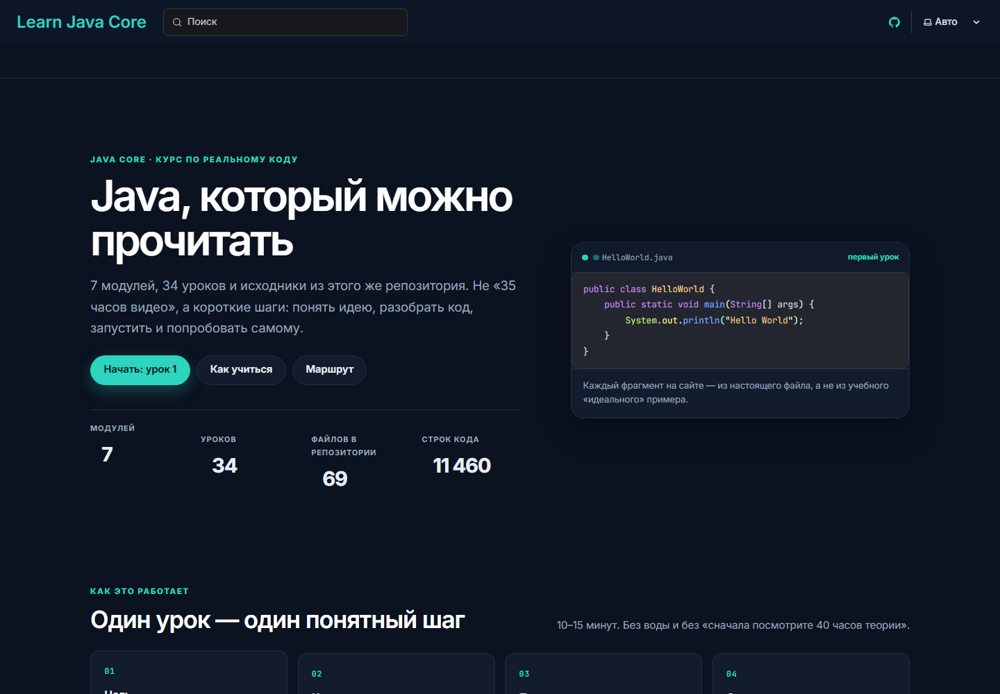
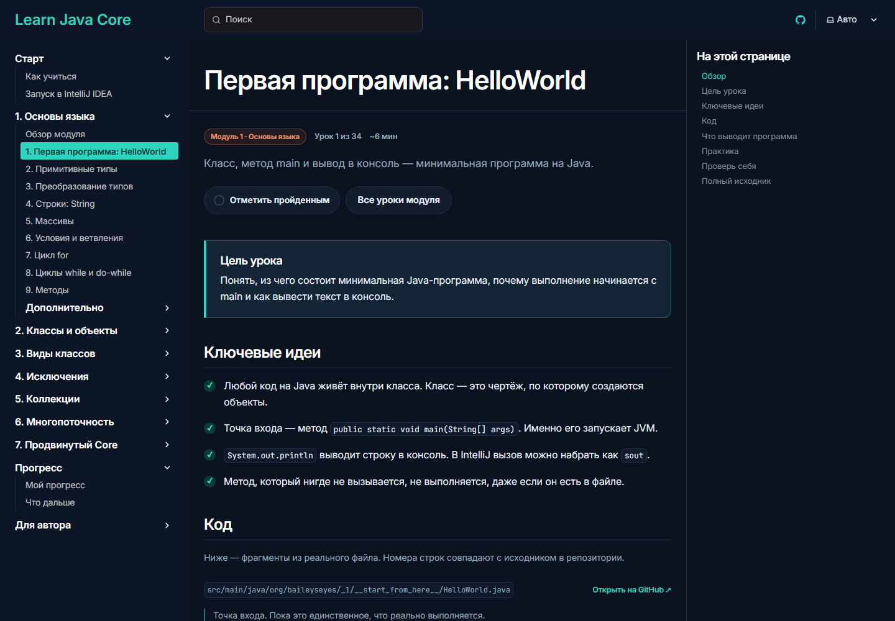

# Обучение Java: Road Map

## Новый курс

В репозитории появился полноценный сайт-курс на **Astro Starlight**: 7 модулей, 34 урока, 69 Java-файлов, упражнения и самопроверка.

**Сайт:** https://baileyseye.github.io/learn-java-core/ (после первого деплоя)

<table>
  <tr>
    <td align="center" width="50%">
      <br>
      <b>Главная</b> — маршрут, прогресс и восемь карточек: семь модулей и «Что дальше»
    </td>
    <td align="center" width="50%">
      <br>
      <b>Урок</b> — цель, идеи, реальный код, практика и самопроверка
    </td>
  </tr>
</table>

Локальный запуск (рекомендуется Node 22; на Node 20 сборка тоже проходит, но npm предупреждает о версии транзитивной зависимости):

```bash
npm install
npm run dev
```

Что внутри:

- уроки с целью, ключевыми идеями, фрагментами реального кода, ожидаемым выводом, практикой и квизом;
- прогресс в `localStorage` с экспортом и импортом;
- поиск по документации (Pagefind), тёмная и светлая темы, мобильная версия;
- дополнительные материалы к каждому модулю;
- раздел «Для автора»: инвентарь файлов и карта маршрута.

### Как это устроено

Java-исходники остаются в `src/main/java` и являются единственным источником правды. Скрипт `scripts/sync-course-data.mjs` читает их, проверяет ссылки на методы и диапазоны строк и генерирует `site/src/data/generated.json`. Скрипт `scripts/capture-outputs.mjs` запускает `main` и сохраняет реальный вывод программ. Метаданные уроков лежат в `site/src/data/course.mjs` и `site/src/data/lessons/`.

```bash
npm run dev          # локальная разработка
npm run sync         # пересобрать данные из Java-исходников
npm run check:data   # проверить, что generated.json не устарел
npm run build        # production-сборка в dist/
npm run capture      # обновить ожидаемый вывод программ (нужен JDK 17+)
```

### Запуск фронтенда из IntelliJ IDEA

В проекте лежат общие Run Configurations (папка `.run/`):

- **Frontend: dev** — запускает `npm run dev` и Astro dev server;
- **Frontend: build** — собирает production-версию в `dist/`.

Выберите `Frontend: dev` в списке конфигураций и нажмите **Run** (`Shift+F10`). Адрес сайта появится в консоли: `http://localhost:4321/learn-java-core/`.

Если IntelliJ при первом запуске попросит Node interpreter, укажите локальный Node (например, `C:\Program Files\nodejs\node.exe`). Дальше настройка сохранится в проекте, и запуск будет в один клик.

### Деплой

Workflow `.github/workflows/deploy-course.yml` собирает сайт и публикует `dist` на GitHub Pages. В настройках репозитория выберите **Settings → Pages → Source: GitHub Actions**.

## Введение
Это роадмап по изучению Java(core). Воспринимать это нужно только как роадмап, после каждой темы самостоятельно гуглить и изучать дополнительно в любом случае придется.

## Обзор Файлов
1. **HelloWorld.java**
    - **Цель:** Демонстрирует создание базового класса в Java с методом `main`, который выводит "Hello World" в консоль.
    - **Ключевые Концепции:**
        - Структура Java-класса.
        - Метод `main` как точка входа.
        - Использование функции `System.out.println` для вывода информации.

2. **PrimitiveTypes.java**
    - **Цель:** Демонстрирует использование примитивных типов данных в Java, таких как `int`, `byte`, `short`, `long`, `float`, `double`, `boolean` и `char`.
    - **Ключевые Концепции:**
        - Объявление и инициализация переменных.
        - Работа с различными типами данных и их диапазонами.
        - Преобразование между примитивными типами.

3. **TypeConversion.java**
    - **Цель:** Демонстрирует преобразование типов в Java, включая узкое и широкое приведение типов, а также преобразование между примитивными типами и строками.
    - **Ключевые Концепции:**
        - Явное и неявное преобразование типов.
        - Преобразование между числовыми типами и строками.

4. **StringType.java**
    - **Цель:** Охватывает тип данных `String` в Java, демонстрируя операции, такие как конкатенация, сравнение и методы работы со строками.
    - **Ключевые Концепции:**
        - Неизменяемость строк.
        - Использование методов `substring`, `trim`, `replace` и `length`.
        - Сравнение строк с помощью `equals()` и `==`.

5. **IntArray.java**
    - **Цель:** Демонстрирует работу с массивами в Java, включая базовые операции, поиск минимального/максимального значения и суммирование элементов массива.
    - **Ключевые Концепции:**
        - Объявление и инициализация массивов.
        - Использование методов класса `Arrays` для сравнения и манипуляции массивами.

6. **IfElse.java**
    - **Цель:** Демонстрирует условные операторы, такие как `if`, `else`, `else-if` и тернарный оператор.
    - **Ключевые Концепции:**
        - Использование условных операторов для выполнения различных блоков кода в зависимости от условий.
        - Работа с логическими операторами (`&&`, `||`, `!`).
        - Использование оператора `switch`.

7. **For.java**
    - **Цель:** Демонстрирует использование цикла `for`, включая базовый цикл `for`, вложенные циклы и цикл `for-each`.
    - **Ключевые Концепции:**
        - Перебор массивов и коллекций.
        - Реализация вложенных циклов для задач, таких как генерация таблиц умножения.

8. **While.java**
    - **Цель:** Демонстрирует использование циклов `while` и `do-while`, объясняя, как выполнять перебор по условиям с использованием этих конструкций.
    - **Ключевые Концепции:**
        - Использование `while` и `do-while` для итерации.
        - Использование `break` и `continue` для контроля выполнения цикла.

9. **Methods.java**
    - **Цель:** Охватывает создание и использование методов в Java, включая методы с параметрами и возвращаемыми значениями.
    - **Ключевые Концепции:**
        - Сигнатура метода и типы возвращаемых значений.
        - Перегрузка методов с различными параметрами.

10. **HelloObjects.java (Начальное ООП)**
    - **Цель:** Вводит в курс дела Java-классы и объекты, помогая новичкам понять, как создавать и работать с объектами.
    - **Ключевые Концепции:**
        - Определение классов и создание объектов.
        - Понимание полей, конструкторов и методов.

11. **Human.java (Продвинутое ООП)**
    - **Цель:** Демонстрирует создание класса `Human` с атрибутами, такими как `name`, `age` и `alive`.
    - **Ключевые Концепции:**
        - Использование аннотаций Lombok для генерации шаблонного кода, такого как геттеры, сеттеры и конструкторы.
        - Создание и манипуляция объектами.

12. **HumanService.java (Слой Сервиса)**
    - **Цель:** Содержит методы для создания и манипуляции объектами `Human`. Этот класс служит посредником между классом `Human` и остальной логикой программы.
    - **Ключевые Концепции:**
        - Методы сервиса для создания и обновления объектов.
        - Использование конструкторов и методов геттер/сеттер для управления объектами.
